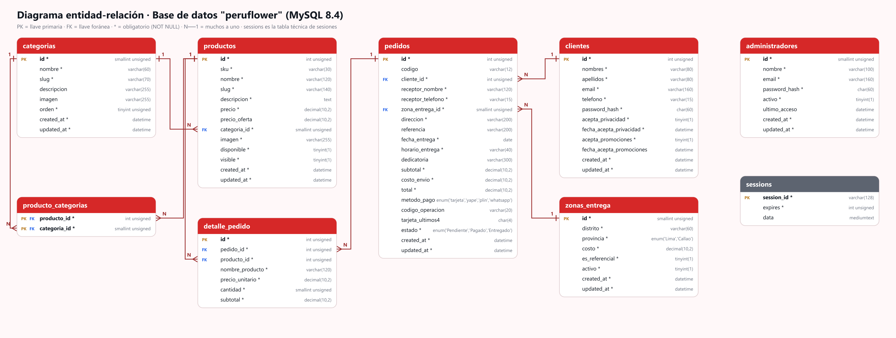

# Peruflower.com

Prototipo funcional de la tienda web de **Perú Flowers**, florería familiar de Salamanca de Monterrico (Ate, Lima).
Proyecto del curso **EFSRT 3: Proyecto de Aplicación Empresarial** (IDAT).

Tecnologías: HTML, CSS y JavaScript · Node.js + Express · MySQL 8.4 · EJS.

## Historias de usuario implementadas

| HU   | Qué hace                                                        | Dónde verlo                                                |
| ---- | --------------------------------------------------------------- | ---------------------------------------------------------- |
| HU01 | Catálogo con foto, nombre y precio                              | `/catalogo`                                                |
| HU02 | Filtros por ocasión y por rango de presupuesto                  | `/catalogo` (ocasiones con imágenes y panel "Presupuesto") |
| HU03 | Detalle de cada arreglo                                         | `/producto/ramo-20-rosas`                                  |
| HU04 | Botón flotante de WhatsApp con el producto que se está viendo   | Botón verde en todas las páginas                           |
| HU05 | Panel: agregar, editar, ocultar productos y subir su foto       | `/admin/productos`                                         |
| HU06 | Registro e inicio de sesión con correo y política de privacidad | `/registro` · `/ingresar`                                  |
| HU07 | Carrito que se mantiene al recargar                             | Ícono del carrito · `/carrito`                             |
| HU08 | Formulario de entrega con validaciones                          | `/pedido/entrega`                                          |
| HU09 | Costo de envío automático según el distrito                     | `/pedido/entrega`                                          |
| HU10 | Panel: pedidos con filtros, detalle y cambio de estado          | `/admin/pedidos`                                           |
| HU11 | Pago con tarjeta (simulado), Yape/Plin o WhatsApp               | `/pedido/PF-000001/pago` y su confirmación                 |

---

## 1. Cómo levantar la página paso a paso

**Necesitas:** Node.js 24 o superior y MySQL 8.4 funcionando (servicio `MySQL84` en `localhost:3306`).

1. **Descarga el proyecto** y abre la carpeta en VS Code.
   ```bash
   git clone https://github.com/pierobz06-design/peruflower-web.git
   cd peruflower-web
   ```
2. **Instala las dependencias** (una sola vez):
   ```bash
   npm install
   ```
3. **Crea el archivo `.env`**: copia `.env.example`, cámbiale el nombre a `.env` y completa:
   - `DB_PASSWORD`: la contraseña del usuario `root` de MySQL.
   - `SESSION_SECRET`: una frase larga y aleatoria (mínimo 32 caracteres).
   - `WHATSAPP_NUMERO`, `YAPE_PLIN_NUMERO` y `YAPE_PLIN_TITULAR`: los datos del negocio.
4. **Crea la base de datos** con sus tablas, los 37 productos, las zonas de entrega y el administrador de prueba:
   ```bash
   npm run db:init
   ```
   Se puede ejecutar varias veces: no duplica datos.
5. **Inicia la página**:
   ```bash
   npm run dev
   ```
6. Abre **http://localhost:3000** en el navegador.
   Para verla en el celular (conectado al mismo WiFi), usa la IP de la computadora, por ejemplo `http://192.168.100.4:3000`. Si no carga, permite Node.js en el firewall de Windows (redes privadas).

> Si aparece "El puerto 3000 ya está en uso", ya hay otra terminal con la página abierta: ciérrala con **Ctrl + C**.

### Comandos disponibles

| Comando                                    | Qué hace                                                                 |
| ------------------------------------------ | ------------------------------------------------------------------------ |
| `npm run dev`                              | Inicia la página y la reinicia sola al guardar cambios.                  |
| `npm start`                                | Inicia la página (sin reinicio automático).                              |
| `npm run db:init`                          | Crea la base `peruflower`, sus tablas, las miniaturas y carga los datos. |
| `npm run db:diagrama`                      | Genera el diagrama entidad-relación en `docs/` leyendo la base real.     |
| `npm run db:vaciar-pedidos -- --confirmar` | Borra los clientes y pedidos para empezar desde cero.                    |
| `npm run lint` / `npm run format`          | Revisa (ESLint) y da formato (Prettier) al código.                       |

---

## 2. La base de datos en MySQL Workbench 26.10

### Abrir la base `peruflower`

1. Abre **MySQL Workbench** y entra a tu conexión **localhost:3306** (usuario `root`).
2. En el panel izquierdo **Navigator → Schemas**, pulsa el botón **Refrescar**.
3. Despliega **peruflower → Tables**.
4. Para ver los registros de una tabla: **clic derecho → Select Rows**.
   También puedes escribir una consulta en el editor y ejecutarla con **Ctrl + Enter**.

### Qué guarda cada tabla

| Tabla                 | Qué guarda                                                                                                                              |
| --------------------- | --------------------------------------------------------------------------------------------------------------------------------------- |
| `categorias`          | Las 5 ocasiones: Cumpleaños, Para Mamá, Arreglos, Box y Condolencias.                                                                   |
| `productos`           | Los arreglos: nombre, SKU, descripción, precio, precio de oferta, categoría principal, ruta de la foto, `disponible` y `visible`.       |
| `producto_categorias` | En qué ocasiones aparece cada arreglo (un arreglo puede servir para varias).                                                            |
| `clientes`            | Clientes registrados, su contraseña cifrada (bcrypt) y si aceptaron la privacidad (Ley 29733) y las promociones (Ley 28493), con fecha. |
| `zonas_entrega`       | Distritos de Lima y Callao con su costo de envío (**valores referenciales**).                                                           |
| `pedidos`             | Cada pedido: número (PF-000001), cliente, datos de entrega, montos, método de pago, número de operación o últimos 4 dígitos y estado.   |
| `detalle_pedido`      | Los productos de cada pedido con su cantidad y el precio al momento de comprar.                                                         |
| `administradores`     | El personal que entra al panel (contraseña cifrada).                                                                                    |
| `sessions`            | Tabla técnica: las sesiones abiertas (por eso el carrito no se pierde al recargar).                                                     |

### Consultas útiles

```sql
USE peruflower;

-- Pedidos con su cliente, distrito, método de pago y estado
SELECT p.codigo, c.email AS cliente, z.distrito, p.total, p.metodo_pago,
       p.codigo_operacion, p.tarjeta_ultimos4, p.estado, p.created_at, p.updated_at
FROM pedidos p
JOIN clientes c ON c.id = p.cliente_id
JOIN zonas_entrega z ON z.id = p.zona_entrega_id
ORDER BY p.id DESC;

-- Productos de un pedido
SELECT p.codigo, d.nombre_producto, d.cantidad, d.precio_unitario, d.subtotal
FROM detalle_pedido d JOIN pedidos p ON p.id = d.pedido_id
WHERE p.codigo = 'PF-000001';

-- Clientes y sus aceptaciones
SELECT nombres, apellidos, email, acepta_privacidad, fecha_acepta_privacidad,
       acepta_promociones, fecha_acepta_promociones
FROM clientes;

-- Productos ocultos desde el panel
SELECT id, sku, nombre, visible FROM productos WHERE visible = 0;
```

Más consultas en [`docs/consultas.sql`](docs/consultas.sql).

### Diagrama entidad-relación

El archivo [`docs/diagrama-entidad-relacion.png`](docs/diagrama-entidad-relacion.png) (también en `.svg`) se genera a partir de la estructura real de la base. Para actualizarlo: `npm run db:diagrama`.



---

## 3. Credenciales y datos de prueba

**Administrador del panel** (se crea con `npm run db:init`, se cambia en `.env`):

| Correo                 | Contraseña   |
| ---------------------- | ------------ |
| `admin@peruflower.com` | `Admin#2026` |

**Clientes:** crea uno desde `/registro` (no hay cuentas de cliente precargadas).

**Tarjetas de prueba** (pasarela simulada: no se cobra nada ni se guarda la tarjeta). Usa cualquier nombre, una fecha futura como `12/30` y el CVV `123`:

| Número                | Resultado             |
| --------------------- | --------------------- |
| `4111 1111 1111 1111` | Aprobada (Visa)       |
| `5555 5555 5555 4444` | Aprobada (Mastercard) |
| `4000 0000 0000 0002` | Rechazada             |

---

## 4. Estructura del proyecto

```
├── src/
│   ├── config/        variables de entorno, conexión MySQL y datos del negocio
│   ├── routes/        rutas de Express (tienda, cuenta, carrito, pedido, admin)
│   ├── controllers/   lógica de cada página
│   ├── models/        consultas a la base de datos (siempre parametrizadas)
│   ├── services/      carrito, pedido, pagos, pasarela simulada, imágenes
│   ├── middlewares/   sesión, CSRF, autenticación, validaciones, errores
│   ├── utils/         formato de precios y fechas, WhatsApp, contraseñas
│   ├── views/         vistas EJS (pages, partials y admin)
│   ├── app.js         configuración de Express
│   └── server.js      arranque del servidor
├── public/
│   ├── css/           base, components y pages
│   ├── js/            components, pages, admin y utils
│   └── img/           productos, banners, ocasiones e iconos
├── database/          schema.sql, datos iniciales, db:init y vaciar pedidos
├── scripts/           generador del diagrama ER
└── docs/              diagrama entidad-relación y consultas SQL
```

## 5. Seguridad

- Contraseñas cifradas con **bcrypt**; consultas **parametrizadas** (sin concatenar SQL).
- Validación en el navegador **y** en el servidor (express-validator).
- Sesiones guardadas en MySQL, cookie `httpOnly` y `sameSite`, regeneradas al iniciar sesión.
- Protección **CSRF** en todos los formularios y en la API del carrito.
- Cabeceras de seguridad con **helmet** (CSP estricta: sin scripts ni estilos dentro del HTML).
- Límite de intentos en el inicio de sesión y en los pagos.
- La tarjeta **nunca** se guarda: solo los últimos 4 dígitos.
- Cada pedido solo lo ve su dueño; el panel exige sesión de administrador.
- Errores con mensajes claros para el cliente, sin detalles técnicos.

## 6. Notas

- Los **costos de envío** por distrito son de ejemplo (`es_referencial = 1`); se deben confirmar con el negocio.
- El **QR de Yape** y el número real no se suben a GitHub (son datos personales): se configuran en `.env`; la imagen del QR se guarda a mano en `public/img/pagos/` (esa carpeta no se sube a GitHub).
- La pasarela de tarjetas es **simulada** para el prototipo; en producción se conectaría a una pasarela real (por ejemplo Niubiz, Izipay o Culqi).
